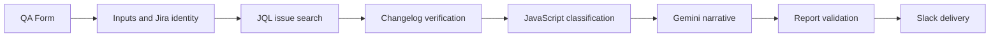

# AI-Powered Daily QA Report Generator

An n8n workflow that brings together **Jira activity**, optional manual QA updates, **Google Gemini** summaries, and **Slack** delivery to produce a consistent daily software quality assurance report.

**Stack:** n8n · JavaScript · Jira REST API / JQL · Google Gemini API · Slack

> **Portfolio demonstration:** This repository contains a redacted, inactive template adapted from a real workflow. It is not a preconfigured integration and has not been executed as part of this public package. Sample reports use fictional data.

## What it does

1. A QA engineer submits a short n8n form for additional activities, blockers, and tomorrow's plan.
2. The workflow retrieves activity from Jira and fetches issue changelogs.
3. JavaScript logic identifies issues **created**, moved from **In QA → Resolved**, and moved from **In QA → Re open** by the authenticated account on the report date.
4. Gemini refines free-text narrative into professional English, under instructions not to alter ticket facts or counts.
5. The workflow constructs and checks a formatted report, then sends it to a selected Slack user.

This workflow is **form-triggered**. It does **not** run on a daily schedule automatically.

## Workflow overview



## Key engineering decisions

- **Deterministic Jira metrics:** Ticket keys, status transitions, and counts are calculated in JavaScript rather than invented by a language model.
- **Changelog verification:** A ticket is considered resolved or reopened only when its matching status transition is attributed to the reporting account on the target day.
- **Validated output:** The Gemini response is checked for required JSON fields; the assembled report is checked for required headings.
- **Timezone-aware reporting:** The configured reporting timezone determines the daily activity window.
- **Operational resilience:** Jira and Gemini request nodes include retry and timeout settings.

## Repository structure

```text
qa-daily-report-generator-n8n/
├── README.md
├── .gitignore
├── workflows/
│   └── qa-daily-report-generator.template.json
└── docs/
    ├── setup.md
    ├── sample-report.md
    └── security-checklist.md
```

## Getting started

See [Setup & configuration](docs/setup.md) for import instructions and the Jira, Gemini, and Slack connections that must be configured before execution.

See [Example QA report](docs/sample-report.md) for an illustrative output using entirely fictional tickets.

## Limitations and configuration notes

- Jira workflow status names and JQL filters are tailored to an example **In QA / Resolved / Re open** workflow. Adjust them to match your Jira instance.
- The form supports manual additions alongside Jira data; this is not a general-purpose reporting system for every Jira project.
- The Jira query uses the authenticated account's `currentUser()`. The identity validation step deliberately checks the configured account ID and timezone.
- API pagination and node response handling should be tested against your Jira volume and n8n version.
- Sending Jira issue content to an external AI API must be explicitly permitted by your organization and data-handling policy.

## Security and disclosure

The workflow export has been sanitized to remove workspace-specific Jira URLs, user identifiers, webhook identifiers, and credential associations. It uses placeholder configuration and is **inactive** by default. Never commit API keys, real ticket content, customer details, internal reports, or original employer exports. Read the [Security checklist](docs/security-checklist.md) before sharing a repository publicly.

## Author

**Muhammad Usman** — Software Quality Assurance Engineer  
[GitHub](https://github.com/usman-siddique) · [Portfolio](https://usman-sqa.vercel.app/)
